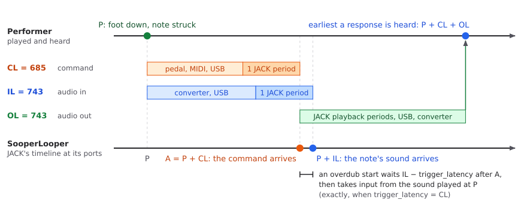
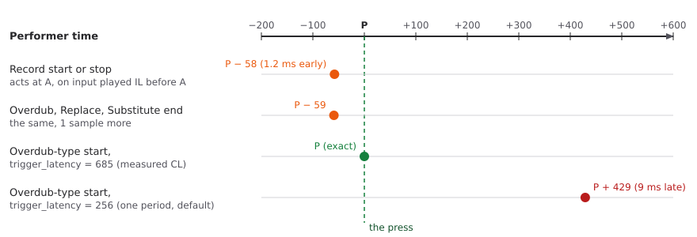
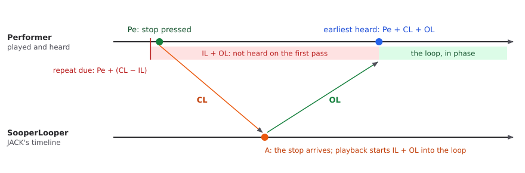

.. Latency in SooperLooper: the delays, the trigger latency setting, and
   where each recording edge lands.

=========================================================================
Latency in SooperLooper: Delays, Trigger Latency, and Recording Edges
=========================================================================

This document pins down the delays between a performer and SooperLooper,
what each of SooperLooper's three latency settings is for, and where the
start and end of each kind of recording actually land.  It is reference
material: the setup guide (``sooperlooper_and_ardour_setup_guide.rst``)
says what to set; this says why, and what is still inexact.

Example figures are from one setup: 48 kHz, 256 frames per period, input
and output latency settings of 743 samples each, and a 5-pin DIN MIDI
pedal into the audio interface's MIDI input.

JACK counts time in *frames*.  A frame is one sample on every channel at
once, so as a length of time a frame is the same as a sample: 1/48000 s
at 48 kHz, and 256 frames is 5.3 ms.  Delays here are given in samples;
a point on JACK's timeline is a frame number.

.. contents:: Contents
   :local:
   :depth: 1

The delays
==========

Four delays matter.  All are in samples on JACK's timeline.

**Audio input latency (IL).**  From a sound at the mic or instrument to
that sound reaching SooperLooper's input port: the interface's converter
and USB transfer, plus one JACK period (JACK delivers a period of captured
audio at the start of the next one).

**Audio output latency (OL).**  From SooperLooper sending a sample to the
performer hearing it: the remaining JACK periods of the playback buffer
(two, with three periods per buffer), plus the interface's USB transfer
and converter.

**Command latency (CL).**  From the performer pressing the pedal to
SooperLooper acting on the command.  It has two parts:

* *The device part*: the pedal noticing the switch, the MIDI message on
  the cable (about 1 ms for three bytes), the interface's MIDI input, USB,
  and the driver.  Only a measurement gives it.
* *How SooperLooper receives the command*:

  - This fork's JACK MIDI input places each command at its exact frame.
    JACK delivers hardware MIDI one period late, as it does audio, so this
    part is exactly one period, with no jitter.
  - Stock's ALSA MIDI input, and OSC in both, timestamp each command
    when it arrives and apply it one period later, at the matching
    position in that period.  That adds exactly one period, and keeps the
    commands' timing relative to each other: no jitter.  (Commands that
    arrived at random points between periods would otherwise all be
    applied at the next period's start, 0 to 1 period late.)

**Trigger latency.**  Not a fourth delay but SooperLooper's *estimate*
of CL: the per-loop setting ``trigger_latency``.  What it is used for is
below.

Input and output latency also have settings (``input_latency``,
``output_latency``), which should match the true delays.  For a plain
loop only their sum matters; the split matters for overdubs (setup guide,
section 2.8).

A press on a timeline
=====================

The performer presses the pedal and strikes a note at the same moment, P.
The command and the note's sound then travel to SooperLooper by different
paths and arrive at different times.

.. Diagrams generated by tools/latency_diagrams.py from its example
   figures; edit and rerun that script rather than the SVG files.

         At P the performer presses the pedal and strikes a note.  The
         command reaches SooperLooper CL = 685 samples later (the pedal,
         MIDI, and USB, then one JACK period); the note's sound reaches
         it IL = 743 samples after P (the converter and USB, then one
         period).  Output is heard OL = 743 samples after SooperLooper
         sends it, so the earliest response to the press is heard at
         P + CL + OL.  An overdub start waits IL minus trigger_latency
         after the command, then takes input from the sound played at P.

To scale, with the example figures.

Everything SooperLooper sends is heard OL later.  It cannot act before a
command arrives, so nothing it plays in response to a press can be heard
before P + CL + OL.

What "trigger" means here
=========================

In SooperLooper's own terms, *Trigger* is the command that restarts a
loop from the top (and *oneshot* plays it once from the top).  The
setting's name suggests a connection, and stock's documentation only
says "Sets the latency for trigger operations", but Trigger never reads
it.  "Trigger operations" means operations started by a command.  The
setting is the delay of commands in general.

Stock reads ``trigger_latency`` in three places only: the start of an
overdub (Replace and Substitute go through the same code), the start of
a Multiply, and the start of an Insert.  This fork adds a fourth: a Rel
Sync recording that starts at the press starts that much earlier, taking
the missing audio from SooperLooper's input history, and ends as much
earlier (see ``late_hit_patch_summary.rst``).

What the setting means
======================

At each of those starts, stock waits

    frames until input = input_latency - trigger_latency

after the command before taking input.  The sound played at the press
reaches SooperLooper IL after the press; the command reaches it CL after
the press; so the sound arrives IL - CL after the command.  The formula
gets that right exactly when ``trigger_latency`` is CL: the whole delay
from the press to the command, whatever its sources.

Autoset sets ``trigger_latency`` to one period, with the comment "jitter
correction" in stock's code.  That refers to the timestamping above:
stock removes the jitter by delaying every command exactly one period,
and a trigger latency of one period compensates that added delay.  It is
a choice of *value*, not a different meaning: it covers the part of CL
that stock itself adds, and leaves out the device part and anything the
MIDI or OSC path adds before the command reaches SooperLooper.  With this
fork's JACK MIDI input the period comes from JACK instead, so one period
is still the least CL can be.  A new loop starts with autoset on, so a
loop whose setting was never touched has one period.

Commands from other sources
===========================

``trigger_latency`` is one value per loop, used for every command
whatever its source: JACK MIDI from a pedal, ALSA MIDI, and OSC,
including slgui's buttons, which send OSC.  Nothing measures or
corrects each source on its own, and their delays differ.  A command
over OSC or ALSA MIDI reaches SooperLooper after the sender's own delay
(for a mouse click, the time slgui takes to send it), and is then applied
exactly one period later (see the next section).  A pedal's command over
this fork's JACK MIDI input arrives at its exact frame after the device's
delay.  So with ``trigger_latency`` measured for the pedal, edges from
slgui or another OSC program land off by the difference.  Clicks in
slgui are rarely that timing-critical; a setup that plays from OSC would
want its own value instead.

Sources of jitter and how they are handled
==========================================

A fixed ``trigger_latency`` can only correct a fixed delay.  Jitter, a
delay that varies from press to press, is left as an error.

* **SooperLooper's own inputs add none.**  Stock's ALSA MIDI and OSC
  inputs timestamp each command and apply it one period later at the
  matching position; this fork's JACK MIDI input places each command at
  its exact frame.  (Measured over OSC: a take's length matched the time
  between the two sends to within a sample.)
* **The MIDI remapper** builds each output event new, and by default
  places it at the start of a period, losing the input's offset within
  the period.  With ``--jack-rt`` the command then reaches SooperLooper 0
  to 1 period *before* its own time stamp; with the buffered backend,
  in the next period, 1 to 256 samples after.  The remapper's
  ``--keep-offsets`` option places each output at its input's offset:
  exact with ``--jack-rt`` (55 live presses all came out on the pedal
  event's own frame), exactly one period later with the buffered backend.
  So through ``--jack-rt --keep-offsets`` the command latency is the same
  as from the pedal directly; through the buffered backend with
  ``--keep-offsets``, one period more.
* **Timed gestures** (a double press, a long press, a single that waits
  for the multi-press window) are sent when the gesture is recognized,
  not at the press, and at the start of a period.  The delay is the
  gesture's own window; no latency setting applies to it.

Where each recording edge lands
===============================

Measured on a dummy JACK server with this fork's engine: input latency
743, output latency 743, sync and quantize off, no crossfade, commands
sent as JACK MIDI at exact frames.  The input was noise; each edge was
found by matching the loop's output against the input.  Each figure is
where the edge lands in the performer's time, relative to the press, for
a command latency of CL.

=====================================  ============================  ===============================
Edge                                   Lands at                      Assumes CL is
=====================================  ============================  ===============================
Record start                           P + (CL - IL)                 IL (``trigger_latency`` unused)
Record stop                            P + (CL - IL)                 IL (``trigger_latency`` unused)
Overdub, Replace, Substitute start     P + (CL - trigger_latency)    ``trigger_latency``
Overdub, Replace, Substitute end       P + (CL - IL), and 1 sample   IL (``trigger_latency`` unused)
Multiply, Insert start                 P + (CL - trigger_latency)    ``trigger_latency``
Multiply, Insert end                   P + (CL - IL), +/- 1 sample   IL (``trigger_latency`` unused)
=====================================  ============================  ===============================

         lands 58 samples before P, and an overdub, Replace, or Substitute
         end 59 before.  An overdub-type start lands exactly on P with
         trigger_latency set to the measured 685, and 429 samples (9 ms)
         after P with the default of one period, 256.

Loop lengths came out equal to the interval between the presses, to the
sample, at both ``trigger_latency`` settings tried (0 and 685).

Every edge except the starts simply acts when the command arrives.  The
input arriving then was played IL earlier, so those edges behave as if
CL were IL.  In the example setup CL - IL is -58 samples (see `Measuring
CL - IL`_): a take starts and stops 1.2 ms *before* the presses, and an
overdub ends 1.2 ms before the press that ends it, so nothing the
performer meant to record is lost.  The overdub start, with
``trigger_latency`` set to the measured 685, lands on the press.  With
the default of one period (256), it would land 429 samples (9 ms) after
the press.

The same measurements, and a few more:

* **Stock 1.7.9** (commands over OSC, since it has no JACK MIDI input)
  gives the same pattern for record, overdub, Replace, and Substitute,
  each edge one period later than the command's arrival, from the
  timestamping.
* **Multiply and Insert** (Round off) follow the overdub pattern, as in
  the table.
* **With sync on**, the late-hit window is measured from the command's
  arrival: a press 196 ms after the beat started at once and one at
  204 ms waited for the next beat (window 200 ms), at a trigger latency
  of 0 and of 685 alike.
* **Playback** after a record stop, and after a Trigger, starts IL + OL
  into the take whatever the trigger latency.

Should an overdub use the same value at both ends?
==================================================

An overdub, synced or not, never changes the loop's length.  It writes
into the existing loop, and its two presses only choose which stretch of
what is played goes in.  So its edges change what is captured, never the
timing.  A plain recording also sets the loop's length, so its start and
stop have to move together; an overdub has no such constraint.

Even so, both ends mark where the performer meant the layer to begin and
end, and both should rest on the same estimate of CL.  At present the start
uses ``trigger_latency`` and the end uses IL.  When the two differ, the end
cuts off the last IL - ``trigger_latency`` before the press that ends it
(if positive) or adds that much after it (if negative).  For an overdub that
is mild, especially with a crossfade.  For Replace the end also decides
where the original comes back, so it shows a little more.

The real-time limit on playback
===============================

Where a recording starts or ends is not tied to when the command
arrives.  SooperLooper can end a recording later than the command by
recording a little longer, or earlier by dropping what it recorded after
the end point.  It can start one earlier, because it keeps the last
stretch of input in an input history, and the start can be taken from
there.  What is heard is different: nothing SooperLooper plays in
response to a press can be heard before P + CL + OL.

After a record stop at Pe, the loop's repeat is due to be heard one loop
after the take began, at Pe + (CL - IL).  The earliest it can be heard is
Pe + CL + OL:

         CL minus IL, slightly before Pe in the example.  The stop command
         reaches SooperLooper CL later, and what it sends is heard OL after
         that, at Pe + CL + OL.  The stretch between, IL + OL long, cannot
         be heard on the first pass; from Pe + CL + OL on, the loop is heard
         in phase, because playback starts IL + OL into the loop.

SooperLooper deals with this by starting playback IL + OL into the loop,
so the loop is heard in phase from its first sample on, and the first
IL + OL of the loop is heard from the second pass on.  Stock does this
after a record stop and the other record endings.

Stock does not do it everywhere:

* **A restart into play** (Trigger, ``mute_trigger`` from Mute, or a
  oneshot) starts the loop at its first sample, so the loop then plays
  IL + OL late until the next restart, with sync on as well.  Fixed in
  this fork (``RESTART_POSITION_FIX``).
* **The end of a rounded Multiply** left the last IL + OL of the new loop
  unwritten.  Fixed in this fork (``MULTIPLY_END_FIX``).
* Playback-sync re-alignment has the restart's problem and is not fixed.

An overdub end has no immediate audible effect (the loop plays on; the
new layer is heard on the next pass), so it is not limited at all.

Why CL tends to be close to IL
==============================

Partly by construction, partly by the hardware:

* **By construction**, both contain exactly one JACK capture period:
  audio and hardware MIDI that reach JACK during one period are both
  delivered at the start of the next.  This is why one period, the
  default, is a poor estimate: it keeps the shared part and treats the
  device part of CL as zero, which is never true for a hardware pedal.
* **By the hardware**, the rest of IL (the audio converter and USB
  audio) and the rest of CL (the pedal, the cable, USB MIDI, and the
  driver) are both a few milliseconds of device delay.  They are similar
  in size, but nothing makes them equal.  In the example setup they differ
  by 58 samples; another pedal or interface can differ by several
  milliseconds either way.

So ``trigger_latency`` = ``input_latency`` is a reasonable guess when CL
has not been measured, and much closer than one period in the example
setup.  It also makes every edge in the table above rest on the same
assumption.  It is still a guess.

Measuring CL - IL
=================

What every edge depends on is CL - IL, and it can be measured directly.
Put a mic right against the pedal, on an input of the same interface the
instruments use.  The switch's click reaches JACK IL after the press, the
command CL after it, so for each press

    CL - IL = command frame - click frame

with no latency setting involved.  The value for ``trigger_latency`` that
puts an overdub start exactly on the press is then

    trigger_latency = input_latency setting + (command frame - click frame)

This holds even if the ``input_latency`` setting is not the true input
latency (for example, an even split of the round trip): the overdub start
waits ``input_latency - trigger_latency`` after the command, which is
then exactly the time from the command to the click's arrival.

In the example setup the command arrived 58 samples *before* the click,
over many presses with a small spread, so ``trigger_latency`` = 743 - 58 =
685.  Two cautions: the click and the switch contact may not be exactly
simultaneous, and a foot press makes some softer noise before the click,
so the click's onset has to be found on the click itself.

The ``sllatency`` tool does not measure this yet: it measures the audio round trip,
shows the current ``trigger_latency``, and leaves it unchanged.

Possible changes
================

The first is partly built, as a compile-time option that is off by
default; the rest are not built.  Everything above describes the default.

* **Use** ``trigger_latency`` **at every recording edge**: record start
  and stop, and the ends of overdub, Replace, and Substitute, each
  waiting ``input_latency - trigger_latency`` after its command (or taking
  from the input history when that is negative), as the Rel Sync early
  start already does.  Exact with a measured value; with the default of
  one period, plain takes would start and stop several milliseconds
  *after* the presses on a pedal like the example's, worse than now.  So
  it would need a way to measure CL first.

  The option ``TRIGGER_LATENCY_ALL_EDGES`` in ``src/plugin.hpp`` does
  this for a record's own start and stop with sync off, and for every
  end of a take or a layer that acts as soon as its command arrives
  (with sync on too, where the command acts at once).  Where
  ``input_latency`` is larger, those edges wait; the command's own
  effect, such as a mute or a new layer, comes that much later as well,
  and a restart in the slack window keeps the loop's phase.  Where
  ``trigger_latency`` is larger, a take starts that much early, from the
  input history, and every end of it is cut back by the same amount, so
  its length is still the interval between the presses and playback
  stays in phase.  The pre-rolls work the same way: a take that starts
  ``sync_preroll_ms`` or ``rel_sync_preroll_ms`` early also ends that
  much early (see ``late_hit_patch_summary.rst``).  Overdub, Replace,
  Substitute, Multiply, and Insert need no option for this: with
  ``trigger_latency`` larger, they already read the input from the
  press, and this fork writes it where it was heard (stock wrote it the
  difference late).  With the option on, a restart that ends nothing
  (Trigger, a oneshot, or ``mute_trigger`` from Mute, with sync off)
  starts ``trigger_latency`` + OL into the loop instead of IL + OL, as it
  happened at the press; and every window (the late-hit windows, the
  mute window, and the slack window in which a Trigger or oneshot with
  sync on acts at once) is decided from the press: it is
  ``trigger_latency`` longer, counted to the command's arrival.  Where the
  loop is placed still counts to the arrival.
* **A measuring mode in** ``sllatency``: presses beside a mic, reporting
  CL - IL and offering to set ``trigger_latency``.
