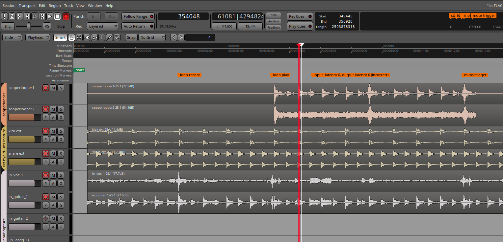
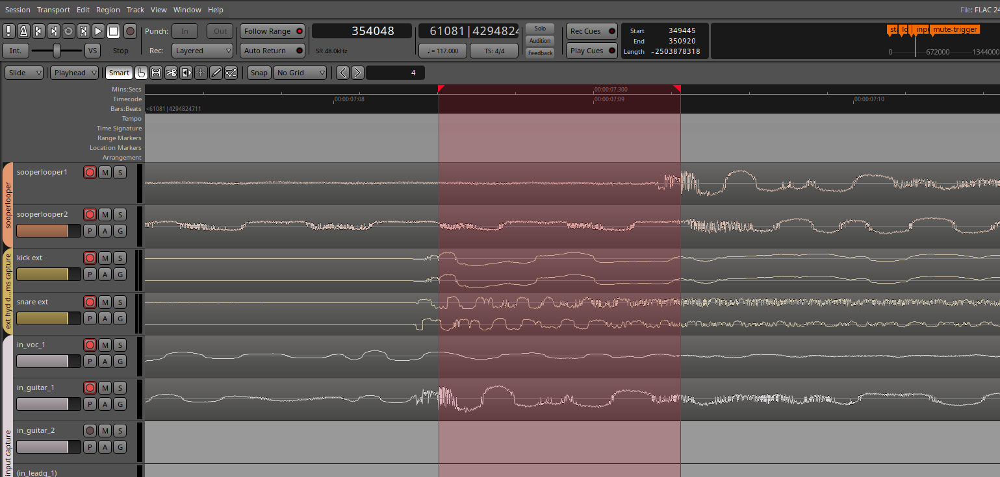
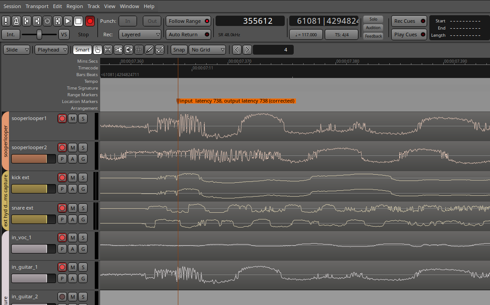
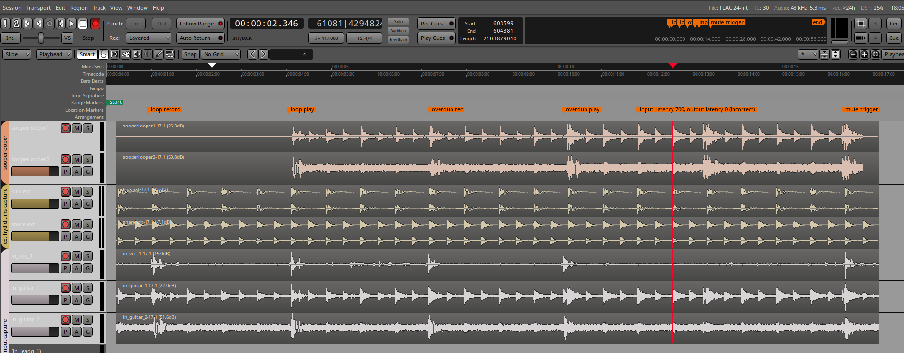
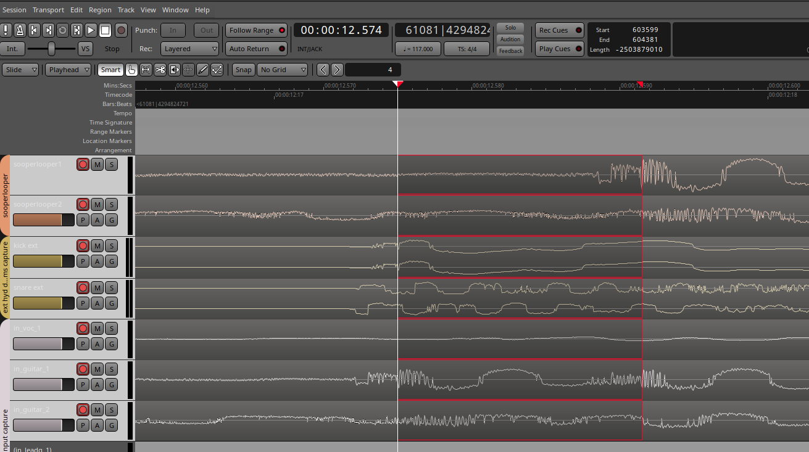

.. SooperLooper + Ardour live-looping setup and latency guide

=========================================================================
Live Looping with SooperLooper and Ardour: A Low-Budget Example Setup
=========================================================================

This guide describes a practical, low-budget live-looping setup on Linux using
a JACK-MIDI--enabled fork of SooperLooper, Hydrogen as the transport/timebase
master, and Ardour for recording and latency verification. It covers software
configuration, signal routing, and -- in the most detail -- latency calibration.

The forked SooperLooper used in this setup is at
https://github.com/abarker/sooperlooper-mods (branch ``late-hit-and-jack-midi``).

**Contents**

- `Overview`_
- `System Description`_
- `1. Setup`_
- `2. Latency: Concepts and Calibration`_
- `3. Automating the Setup`_

.. note::

   This guide assumes the modified SooperLooper 1.7.9 from the fork above,
   which adds **late-hit corrections** and **direct JACK MIDI** I/O. Stock
   SooperLooper 1.7.9 does not support JACK MIDI; with it you have to route
   MIDI over ALSA using ``aconnect`` and **a2jmidid**. With this fork you
   connect directly over JACK and skip ALSA entirely.

Overview
========

This is a fairly low-budget setup built around commodity Linux audio hardware
and open-source software. It lets you build loops locked to a Hydrogen drum
pattern and record the result in Ardour with sample-accurate alignment. The
Hydrogen beat plays continuously in the background as a click track and sync
source.  The beat is not captured in a loop, but can be recorded with the DAW for
mixing purposes and/or played through a PA. The bulk of the work in getting
it to feel right is **latency calibration** -- making sure the loop you record
lines up with what you actually heard when you played it. That is covered in
detail in `2. Latency: Concepts and Calibration`_.

The signal/control chain at a glance:

* A four-button **ActitioN** MIDI footswitch sends momentary CC events
  (press + release).
* A **remapper** program turns those raw events into higher-level gestures
  (chords, long-presses, repeat-on-hold, double-taps) and switches banks.
  One dedicated bank controls Hydrogen -- patterns, tempo, and so on. This
  allows switching drum patterns mid-performance from the footswitch, for
  example moving between a 4/4 and a 3/4 pattern.  The remapper is optional,
  but adds gestures like long press, double press, etc., which allow more
  commands to be bound to a fixed number of buttons.
* SooperLooper receives the mapped MIDI and records/plays loops, always
  locked to the Hydrogen beat while JACK transport is running.
* Hydrogen runs in pattern mode as the JACK timebase master. Its drum
  pattern acts as a click track -- it can be any Hydrogen pattern, simple or
  complex.
* Big Tempo monitors JACK transport state (Hydrogen, as timebase master,
  controls transport start/stop). When transport starts or stops, Big Tempo
  sends MIDI to toggle SooperLooper's sync and mute-quantize state accordingly,
  so loops can be recorded either locked to the Hydrogen beat or free-running.
  Big Tempo also displays a large tempo readout for the performer.
* Ardour records everything and can be used to measure and verify latency.

System Description
==================

============================  ===================================================
Component                     Detail
============================  ===================================================
OS                            Ubuntu 24.04
Kernel                        Generic kernel (low-latency settings applied)
JACK                          JACK2 standalone server
SooperLooper                  1.7.9, forked: late-hit corrections + JACK MIDI
MIDI footswitch               ActitioN four-button MIDI controller
Audio interface               Behringer UMC404HD (four inputs)
Mixer                         Behringer Xenyx 802S
============================  ===================================================

.. note::

   The dedicated low-latency kernel is probably the better audio choice, but
   the generic kernel is used here because it includes a driver needed for
   other hardware that the low-latency kernel currently lacks.

.. note::

   Big Tempo and the remapper both depend on ``mididings``, which requires
   JACK and is built for Linux; a community-maintained fork also lists
   macOS as supported, though that has not been tried for this setup.
   Windows is not supported by ``mididings``.

1. Setup
=========

1.1 JACK
---------

This setup uses the **JACK2 standalone server**, launched via QJackctl or a
startup script. Ubuntu 24.04 ships with a native PipeWire-JACK bridge that
presents itself as JACK to applications, but it does not expose the hardware
latency fine-tuning fields in QJackctl (Setup -> Advanced -> Latency I/O) that
this setup relies on. Use the standalone JACK2 server instead.

**Transport / timebase master**

Set **Hydrogen** as the JACK timebase master.

**Zero-latency monitoring**

For better sync -- especially at larger JACK buffer sizes -- use the
interface's zero-latency / direct-monitoring path. The UMC404HD has 1/4" TRS
insert points on all four input channels (tip = send, ring = return, sleeve =
ground). To tap a zero-latency feed, short the send (tip) and return (ring)
together and wire that junction as the output signal, with the sleeve as
ground. Route this to the **Xenyx 802S** mixer, which sends it on to the
headphones or other monitor. The insert cables for this are straightforward to
make.

**JACK buffer settings**

The buffer size and period count affect both latency and stability: lower
values reduce latency but risk xruns, depending on the hardware and system
load. As an example, this setup currently uses **256 frames/period** and
**3 periods/buffer**. See `2. Latency: Concepts and Calibration`_ for how
to measure round-trip latency and how these values feed into the QJackctl
settings.

**JACK connections**

The key audio and MIDI connections needed for this setup are:

* Remapper MIDI out -> SooperLooper MIDI in
* Remapper MIDI out -> Hydrogen MIDI in (drum bank commands)
* Big Tempo MIDI out -> SooperLooper MIDI in (sync/mute-quantize toggle)
* UMC404HD capture ports -> Ardour track inputs (guitar mic, etc.)
* SooperLooper audio out -> Ardour track inputs (for loop recording)
* Hydrogen audio out -> Ardour track input (for direct drum reference)
* Ardour/SooperLooper/Hydrogen audio out -> UMC404HD playback ports

The full set of port names is hardware- and session-specific. In practice,
connections are made by a startup script using ``jack_connect`` or the
JACK Python API (``jacklib`` / ``jack``). Only the connections above need
to be established; internal Ardour and Hydrogen routing is handled within
those applications.

1.2 SooperLooper
-----------------

SooperLooper is started with **slgui**, the GUI front-end built from this
fork. A separate companion window, **slbigstate** -- also part of this fork,
with no equivalent in stock SooperLooper -- can optionally also be launched
alongside it; its only job is to make SooperLooper's current state (which
loop is recording, playing, muted, and so on) instantly visible at a
distance, for when the pedal, not the screen, is where your attention is.

**Connecting MIDI**

With this fork, connect SooperLooper directly over **JACK MIDI** -- no ALSA,
no a2jmidid. (Stock SooperLooper 1.7.9 must be reached over ALSA with
``aconnect`` and ``a2jmidid``.)

If the pedals go through the remapper, start it with ``--jack-rt``. Commands
then reach SooperLooper one JACK period sooner (about 5 ms at 256 frames), as
early as with the pedal connected directly. The option runs the remapper's
handler inside JACK's audio thread, so watch JACK's xrun count for a session
or two afterwards, and drop the option if xruns go up.

**Learning and saving MIDI bindings**

Choose whatever MIDI channel and signals you want to drive SooperLooper, then
use the **slgui "learn"** function to bind those actions. Test that
SooperLooper recognizes each incoming MIDI signal while learning before
moving on.

When the bindings are right, **save them** -- slgui does not retain them
automatically. SooperLooper stores bindings in an ``.slb`` file; this setup
uses ``sl_midi_config_actition_bindings.slb``. (Hydrogen remembers its MIDI
setup automatically.)

.. warning::

   **A binding's Type decides whether it fires on press, on release, or on
   both -- and the names read backwards.** In slgui's binding editor, a
   control-change binding can be Type **CC**, **CC On**, or **CC Off**. Of
   the three, **CC Off** fires only on the press (it suppresses the
   release/zero message), **CC On** fires only on the release, and plain
   **CC** fires on both.

   This matters for command buttons like record: bind one as plain **CC**
   and the same press-then-release pair fires the command twice -- record
   switches on and straight back off. Every command-style binding in this
   setup therefore uses **CC Off**, which avoids that.

On the ActitioN footswitch, each button sends a **momentary CC** event -- a
press followed by a release. The remapper layers gestures on top of these raw
events and handles bank switching.

The core button actions:

============== ==============================================================
Button         Action
============== ==============================================================
record         Records on the first press; plays the recording on the second.
mute_trigger   Mutes active playback and restarts the loop from the top on
               unmute. Effectively the **Stop** button.
undo           (optional) Undo the last action.
overdub        (optional) Layer additional material onto the loop.
============== ==============================================================

.. note::

   SooperLooper is always running; ``mute_trigger`` is a "stop everything you
   can hear" command -- the loop cycles silently and resumes from the start
   when unmuted. Pressing **record** while recording begins playback of what
   was just recorded.

**Sync and quantize settings**

These are the settings currently in use -- one example, not a universal
recommendation:

* **Sync** -> Jack/Host
* **Quantize** -> Cycles
* **8ths per cycle** -> 2  (one example choice, giving quarter-note
  quantization)
* **Crossfade (xfade)** -> ~200 samples for smoother transitions. The right
  value depends on material, tempo, and timing accuracy. Set it to **0**
  during latency calibration.

When JACK transport is running, SooperLooper is always locked to the Hydrogen
beat. Since Hydrogen is the JACK timebase master, it controls transport
start/stop. Big Tempo detects these transport changes and sends MIDI to
SooperLooper to toggle sync on and off, which is what allows recording a loop
either locked to the beat or free-running.

.. note::

   You *can* loop a drum part -- for example, if you play a beat on a drum
   controller and loop it. But in normal use the Hydrogen pattern simply runs
   in the background as the click and sync source and is not captured into the
   loop.

**A pedal-gesture arrangement (example)**

This is the specific footswitch arrangement currently in use. It centers on
three looping buttons -- **record/play**, **mute_trigger**, and **overdub** --
with the remapper adding long-press gestures on top. The four-button switch's
fourth button toggles the Hydrogen drums on and off, and on a long press
returns to the drum-control bank (patterns, tempo, and so on).

Gestures normally cost latency: to tell a long press apart from a plain press,
the remapper must wait out a threshold before it knows which gesture occurred,
and only then fire. **Record is the most latency-sensitive action in the
setup**, so it cannot afford that wait. The remapper avoids the cost with an
**eager single**: the single-press command fires *immediately*, and then --
only if the button is still held past the long-press threshold -- the gesture's
additional command(s) fire as well. The first press keeps zero added latency;
only the follow-up gesture is delayed.

A long press is used here rather than a double tap. A double tap could be
triggered accidentally by a bad or doubled record hit in the heat of a
performance, which on the record button is unacceptable; a deliberate hold is
much harder to trigger by accident.

.. note::

   Overdub is less latency-sensitive than record, but not immune. Unlike a
   record press, an overdub press does not define a loop boundary, so a small
   delay does not create a sync error -- it only shifts where the overdub window
   opens and closes. With **unquantized** overdub (used in this setup) a delayed
   press clips a little material at the edges of the overdub region; with
   **quantized** overdub the boundary snapping absorbs small delays entirely,
   but a delay large enough to cross a quantize boundary jumps the start or end
   by a whole quantize unit.

**Long press on record -> cancel the record, keeping the loop.** The goal is
to hold the record button to abandon a take you have just started, without
losing what was already there. Because the eager single has *already* fired a
real ``record``, the long press cannot simply mute -- it has to retract that
record too.

This is now a single command, ``cancel_record_mute``, added to SooperLooper
for this purpose. The remapper's long press sends it and nothing else.

What it does depends on how far the record has progressed:

.. list-table::
   :header-rows: 1
   :widths: 34 66

   * - State when the long press lands
     - Result
   * - Recording (past the boundary)
     - The take is discarded, the previous loop is restored, and the looper
       is left **muted**.
   * - Record still pending on the sync boundary
     - The pending record is cancelled and the loop **keeps playing** --
       nothing was captured, so there is nothing to hide.
   * - Anything else (playing, or ending a record)
     - **Nothing at all happens.**

That last row is what makes the gesture safe to overload. If you press to
*end* a record and your foot lingers past the threshold, the take is kept.

Accepted trade-off: if you meant to record and lingered anyway, the take
dies. The long-press threshold (400 ms) needs to stay comfortably longer than
a normal stomp.

The command being **state-aware** is what makes one switch able to carry both
jobs. It can tell a record that actually started from one still waiting on
the boundary, and it knows when there is no record to cancel at all -- so the
same gesture that rescues a bad take is harmless when there is nothing to
rescue. A remapper sending plain ``mute_on`` and ``undo`` cannot see any of
that, and this replaces that older arrangement.

.. note::

   Open question from live use: in the *pending* case the command currently
   leaves the loop playing rather than muting. If the long press is being
   used as a general "stop" gesture -- and with sync on the pending case is
   the common one -- muting there too may be preferable.

.. note::

   Bind these as immediate (Note-on / CC) actions and let the remapper own all
   gesture recognition. Do **not** also use SooperLooper's built-in Note
   long-press: its long-press for Undo is *Undo All*, which clears the whole
   loop stack rather than retracting a single record.

**Cancelling a record -- an inherent trade-off.** Be cautious with the record
long-press. There is **no way to avoid** the following: the start of a genuine
record/play press is indistinguishable from the eager single that precedes a
long press that may or may not arrive.  The system cannot know a long press is
coming, so the eager single must fire, and the loop can briefly become audible
during the long-press wait interval before ``cancel_record_mute`` retracts it.
(Without eager single being set and no multiple-press gestures defined for the
button the record command would fire on release, since at that point it can
rule out long press.) The most likely accidental trigger is a lingering
press on the **record/play** switch -- if the foot rests on the pedal past
the long-press threshold, the gesture fires and cancels a take meant to be
kept. Deliberately cancelling an in-progress recording is therefore done on the
**mute_trigger** button instead, which drops to silence immediately with no
audible wait interval.

**Record failsafe: a safety net for when nobody presses anything.** The
``cancel_record_mute`` command above still needs a press. Tapping record to end
a playing loop's playback fires a real recording immediately -- if that was
actually meant to be a long press to cancel instead, or attention just went
elsewhere before pressing anything else, that recording runs forever with the
previous take gone underneath it. SooperLooper now has a timeout for exactly
that: leave a loop recording past ``record_failsafe_seconds`` after it cut off
an existing, playing take, and it auto-cancels back to that take, muted, the
same as if the long press had landed. It only ever fires for a record that
interrupted playback -- a fresh recording into an empty loop is never affected.

It ships **off by default**. To turn it on, add the key to the session
file's ``<Globals>`` line and restart::

    record_failsafe_seconds="45"

(seconds; ``0`` or omitted means off). Pick a value comfortably longer than
your longest legitimate take on this rig -- including a deliberate new
take started right after stopping playback, since that also counts and
gets cut off at the same timeout.

**Mute/unmute late-hit correction.** With mute-quantize on, pressing
mute or unmute a moment after the beat normally waits for the *next*
beat before acting -- up to a full extra cycle either muted when you
meant to be playing, or playing when you meant to be muted. This lets a
press shortly after the beat act immediately instead, the same idea as
the Record late-hit correction above, applied to mute and unmute.

It ships **on by default** (100 ms, matching the Record late-hit
correction above) -- no setup needed to get it. To turn it off, or to
use a different window, add the key to the session file's ``<Globals>``
line and restart::

    mute_late_hit_ms="0"

(milliseconds; ``0`` disables it). Keep it small if you tune it -- this
is meant to catch a slightly-late press, not to make mute-quantize
sloppy.

1.3 Ardour
-----------

Ardour's track alignment setting determines whether JACK's latency compensation
is applied when recording. The correct setting differs by source:

* **Hydrogen and SooperLooper tracks** -> align to **capture time**. Both are
  generated entirely in software and reach Ardour directly via JACK, with no
  hardware round-trip. There is no latency for Ardour to compensate, so
  recording at the raw capture position is correct.
* **Guitar, vocal, and other hardware-source tracks** -> align to **existing
  material**. These signals travel through the full hardware round-trip (output
  latency to the headphones/monitor, input latency back from the mic or
  instrument). Ardour compensates using JACK's reported latency to keep them
  in sync with the rest of the session.

Right-click a track header and choose *Alignment* to set this per track.

For multitracking to work correctly, JACK must have accurate hardware latency
information. See `2.4 Setting the QJackctl hardware latency`_ in the next section.

2. Latency: Concepts and Calibration
======================================

This is the part that makes or breaks the feel of the setup. The goal:
**a loop you record should line up exactly with what you heard when you played
it.** This means accounting for the full delay between your instrument and the
recorded sample.

2.1 Where latency comes from
-----------------------------

Round-trip audio latency through JACK has three main parts::

   total_roundtrip_frames = capture_hw_latency
                          + (periods_per_buffer × frames_per_period)
                          + playback_hw_latency

Here ``total_roundtrip_frames`` is the total delay in audio samples (frames)
from the moment a signal enters the ADC until the resulting output is heard
from the DAC -- essentially the number of samples of end-to-end delay in the
system.

To convert frames to milliseconds::

   latency_ms = frames / sample_rate × 1000

2.2 Latency asymmetry: software vs. hardware sources
------------------------------------------------------

Not all signals in this setup travel the same path, so they accumulate
different latencies:

* **Hydrogen drums -> headphones.** Hydrogen generates audio entirely in
  software. It reaches the player's ears via JACK output buffering and the DAC
  only -- so the delay is **output/playback latency only**.
* **Guitar or vocal -> headphones** (monitoring through the interface).
  The signal goes all the way through ADC -> JACK input buffer -> JACK output
  buffer -> DAC -- the **full round-trip latency**.
* **Multitracked guitar/vocal recorded in Ardour** (with *align to existing
  material*). Ardour applies JACK's compensation automatically; the
  full round-trip latency must be correctly reported to JACK via the QJackctl
  hardware latency settings for this alignment to be accurate.

2.3 Measuring round-trip latency
----------------------------------

There are two complementary approaches:

**jack_iodelay:** loop a JACK output back to a JACK input with a cable to
measure the total round-trip in frames and ms directly.

**Drum-beat recording method:** record a Hydrogen beat directly into Ardour
(Track A), then play Track A back while recording the interface output into a
new track (Track B). With tracks set to *align to capture time*, the sample
offset between matching peaks in Track A and Track B is the total round-trip
latency -- the same number ``jack_iodelay`` gives, but measured through the
actual signal chain. Zoom in on the drum waveform to find a sharp transient or
a recognizable feature where the two tracks should align, or simply use the
very start of the recording.

.. note::

   When recording reference tracks for latency analysis, **renormalize** them
   in Ardour after recording. This brings peaks to a consistent level and makes
   waveform features much easier to compare visually.

Both methods yield the same value. The drum-beat method also validates the real
signal chain end-to-end rather than a loopback path.

2.4 Setting the QJackctl hardware latency
-------------------------------------------

QJackctl's **Setup -> Advanced -> Latency I/O** has two fields:

* **Input Latency** -- the ADC delay: the time the interface takes to convert
  an incoming analog signal (mic, instrument) into digital audio that JACK
  can see.
* **Output Latency** -- the DAC delay: the time the interface takes to convert
  JACK's digital output back to an analog signal at the headphone or line
  output.

These are the hardware converter delays that JACK does not know about
automatically. JACK already accounts for its own software buffer delays
(determined by the frames/period and periods/buffer settings) internally, so
those must be excluded when calculating what to enter here.

**Using jack_iodelay:** Set both fields to zero first, then connect a patch
cable from a JACK output back to a JACK input and run ``jack_iodelay``. It
measures the total round-trip and reports the values to enter directly. You
can also tweak the values slightly after an initial measurement if subsequent
testing shows the compensation is a little too high or too low.

**Using the drum-beat method:** Subtract JACK's known buffer contribution from
the measured total and split the remainder evenly between the two fields::

   hw_latency_total = measured_offset - nperiods × period_size
   Input Latency    = hw_latency_total / 2
   Output Latency   = hw_latency_total / 2

Setting these correctly is necessary for **Ardour multitracking**: any time you
record guitar, vocals, or other tracks in Ardour and expect them to line up
with existing material, JACK needs accurate latency information to apply
automatic compensation.

.. note::

   SooperLooper's own input/output latency settings (see below) are a
   *separate* compensation mechanism. The QJackctl values correct JACK's
   latency reporting for all clients; the SL values shift SL's recorded
   material directly. They are set independently.

2.5 Worked example (this setup)
---------------------------------

Settings: **256 frames/period**, **3 periods/buffer**, **48 kHz**.

JACK's internal buffer contribution::

   nperiods × period_size = 3 × 256 = 768 frames

Measured round-trip (``jack_iodelay`` or drum-beat method): approximately
**1458 frames** (**30.4 ms**).

QJackctl hardware latency::

   hw_total   = 1458 - 768 = 690 frames  (~14.4 ms)
   each box   = 690 / 2    = 345 frames  (~7.2 ms)

This setup has 343 in each box, which JACK then reports as a 1454-frame round
trip -- a few frames short of the measurement, well within what matters.

SooperLooper latency settings (compensating for the full round-trip directly,
independent of QJackctl): a total of about **1470 frames** (**30.6 ms**) --
the round trip plus the 16 frames of plugin latency on the Ardour route that
SooperLooper's output goes through -- split evenly, about **735 frames** each
for SL input and SL output latency (see section 2.8).

2.6 Why SooperLooper needs its own latency settings
-----------------------------------------------------

When you press **record**, SooperLooper captures audio arriving at its input
*now*. But the timing reference you played against -- the Hydrogen beat in your
headphones -- reached your ears only after the output/playback latency. The
full round-trip latency separates "when you heard it" from "when the soundcard
saw it." SooperLooper's input and output latency settings shift newly recorded
material earlier so the loop sits where you heard it, not where it physically
arrived at the hardware.

As a practical guide when calibrating: **increasing** either latency value
moves the newly-recorded material to the **left** (earlier in time);
**decreasing** it moves material to the **right** (later in time).

2.7 The monitor-feedback calibration method
--------------------------------------------

In normal performance the signal path is:

  Hydrogen beat -> headphones -> **player hears, plays along** -> guitar ->
  guitar mic -> recorded

The calibration method short-circuits the player out of this loop. The
headphones (playing the Hydrogen beat) are placed on or near the guitar mic,
so the mic picks up the drum signal as a stand-in for a live guitar
performance. What gets recorded on the guitar track is the same signal the
player would have been hearing -- a proxy for the guitar part that would have
been played. When SooperLooper captures a loop, the drum signal in the loop
stands in for the looped guitar, for both plain loops and overdubs. With the
player removed, all three reference signals can be compared as waveforms and
any latency offset shows up directly.

For this test, **turn the SooperLooper monitor down** so the guitar mic
captures only the Hydrogen beat from the headphones. This gives a clean
reference track representing what a player would have heard, with no SL
playback bleed to confuse the comparison.

Use a drum pattern where the downbeat is easy to pick out, and set
SooperLooper's crossfade (``xfade``) to **0** for clean transition data. After
recording, **renormalize** the reference tracks so waveform features are easier
to compare.

.. note::

   If using late-hit correction, **do not use the first beat** as your
   reference point. The first beat may be slightly delayed if the
   stop-recording hit came in late and was corrected. Start measurements from
   the second beat or later.

The three signals to compare:

1. **Hydrogen recorded directly into Ardour.** The timing reference -- no
   analog chain, no hardware latency.

2. **The guitar-mic signal through the full chain.** Headphones placed on or
   near the guitar mic; the mic records the beat after it has passed through
   the complete output -> analog -> input path. This represents the guitar
   signal a player would have recorded while hearing that beat.

3. **The SooperLooper loop**, caught in **sync** mode. This represents the
   looped guitar -- for both plain loops and overdubs.

All three should align at the start of each beat:

* If the **mic'd signal (2)** does not line up with the direct Hydrogen track
  (1), the offset is JACK I/O latency. Measure it (see below) and adjust the
  QJackctl hardware latency values accordingly.
* If the **looper (3)** does not line up, adjust SooperLooper's input/output
  latency settings.

*Measuring the offset in Ardour:* First make the selection clock visible if it
isn't already: **Edit -> Preferences -> Toolbar**, check the box to display the
selection clock, then right-click it and choose **Samples** as the unit. Once
enabled, the selection clock appears in the toolbar above the tracks and shows
the **Start**, **End**, and **Length** of any selected range -- the Start and
End values visible in the images below come from this clock. The **Length**
field shown there is *not* simply End minus Start and should not be used; read
the offset as End minus Start from the Start and End fields, or note that a
correctly configured selection clock may show the length directly in some
Ardour versions. When in doubt, compute End minus Start.

Create a range with one end on a recognizable point in the in-sync waveform
and the other end on the corresponding point in the off-sync waveform. Zooming
in on the drum waveform makes it easy to identify matching transients -- a
sharp attack at the start of a beat works well -- though the very start of the
recording is also fine. Ranges are easy to create and drag to adjust, so you
can line up the endpoints precisely before reading the value.

.. note::

   Ardour's waveform display has some graphic quantization at high zoom levels:
   range endpoints do not move in exact single-sample steps. As a result, the
   measured offset may be off by a few samples from the true value. After
   applying an initial correction, it is worth repeating the test and tweaking
   the value slightly if the visual alignment still looks imperfect. For
   example, a measured total of ~1476 samples might be entered as 738/738, but
   zooming in further and comparing transients may show that 743/743 gives a
   marginally better visual match -- a small difference, but one that can exceed
   the apparent display resolution.

The images below show the error state (latency 0/0, offset ~1475 samples) at
normal and zoomed views, followed by the corrected state (738/738). In these
recordings the vocal mic was placed on the floor next to the footswitch,
capturing a spike on every button press -- visible as sharp transients on the
vocal track. Some of that click noise also bled into the guitar mic, which
muddies the loop transitions slightly. The range Start and End values visible
in the selection clock above the tracks give the offset as End minus Start.

2.8 Input vs. output split, and why it matters for overdubs
-------------------------------------------------------------

Both SL latency settings shift newly recorded material earlier. For a **plain
loop** -- record, then play -- only their *sum* matters; the whole ~1470 frames
could go into either box.

**Overdubs** are different. An overdub plays the existing loop back *while*
recording new material on top, so playback delay and capture delay act on two
different signals. That is why the total is split roughly evenly (SL input
latency ~735 / SL output latency ~735).

*Overdub split test:* For this test, **turn the SooperLooper monitor up**
(the opposite of the regular calibration test described in section 2.7 above).
With the SL monitor on, the guitar mic picks up both the Hydrogen beat from the
headphones *and* the SL loop playback -- a double-beat signal. With sync
enabled, engage overdub while the loop (which contains the recorded drum beat)
is already playing. The loop is periodic, so where in the cycle you enter
overdub does not matter. If the input/output split is correct, the two beats
merge into a single waveform; if not, two offset peaks are visible. Measure
the distance between corresponding peaks and adjust the split.

The images below show an incorrect split (input latency 700, output 0) and the
resulting ~782-sample offset visible when zoomed in:

2.9 Additional tests
---------------------

* **Footswitch-noise marker.** Place a mic on the floor next to the footswitch
  to capture the mechanical click of the switch. This is especially useful in
  no-drum mode: without sync, the loop starts playing immediately on the button
  press rather than waiting to quantize to the beat, so you can directly observe
  the latency between the switch click and the start of loop playback.

* **Constant-signal / fan test.** Turn on a fan next to the guitar mic to
  provide a continuous signal (with or without drums). This can give a cleaner
  picture than the drum method because there is typically a short silence before
  the first drum beat -- the fan signal starts immediately and makes the loop
  start edge easy to see, though you can often also spot the noise floor rise
  even before the first drum hit.

3. Automating the Setup
========================

Once the setup is dialed in, automate the repetitive parts:

* **MIDI bindings.** Save from slgui as an ``.slb`` file (this setup uses
  ``sl_midi_config_actition_bindings.slb``). Hydrogen remembers its MIDI setup
  automatically.
* **SooperLooper session.** Save the full session to restore the loop/sync
  configuration and latency settings. Keep a separate file per buffer size
  since the latency settings differ: ``SL_session_save_256.slsess`` and
  ``SL_session_save_512.slsess``. SooperLooper has two save-session options
  (both called "save session"): one saves configuration only -- loop counts,
  sync settings, latency values, and so on -- and the other also saves the
  recorded audio. For restoring a startup configuration, use the
  configuration-only option.
* **JACK connections.** Use a startup script with ``jack_connect`` or the JACK
  Python API to reconnect ports automatically. See the connection list in
  `1.1 JACK`_ for the key connections to include.
