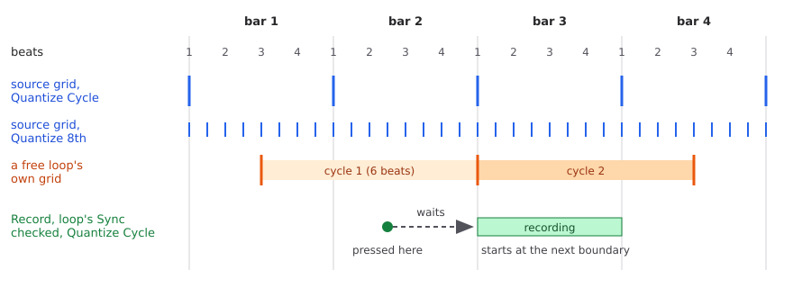

Sync, Quantize, Round, Rel Sync, Multiply, and Eighths/Cycle
=============================================================

SooperLooper can line its actions up with a beat: start a recording on the
bar line, end an overdub on the next beat, keep a loop in step with a drum
machine.  Several settings work together to do this, and the way they
combine can be confusing.  The word "sync" alone names two
different controls, and Quantize matters in places you would not expect.
This guide explains how the settings fit together, then each one in turn,
then some setups for live use.  It describes the SooperLooper in this fork;
where the fork adds or changes something, the text says so.

A cycle -- the unit SooperLooper syncs to -- can be any number of eighth
notes, set by Eighths/Cycle: 2 for every beat, 6 for a bar of 3/4, 8 for a
bar of 4/4, 16 for two bars, and so on.  The examples use 8, at a tempo of
120 BPM, so one cycle is one bar of 4/4 and lasts 2 seconds.

.. contents:: Contents
   :local:
   :depth: 1

How it fits together
--------------------

SooperLooper can hold an action back until a **boundary**: a point on a
regular grid in time.  When the boundary arrives, the action happens.
There are two kinds of grid.

- **The source's grid** comes from the sync source (the **Sync To**
  selector) and the **Quantize** setting together.  With Quantize set to
  Cycle there is one boundary per cycle: with Eighths/Cycle 8, one per bar
  of 4/4; with 2, one per beat.  With 8th there is one per eighth note.
  With Off there are none.
- **Each loop's own grid** has a boundary at the end of each of the loop's
  cycles, counted from where the loop was recorded.  A loop recorded with
  its Sync box checked starts on a source boundary, so its own grid lies
  on the source's grid.  A loop recorded freely has a grid of its own.

         with Quantize Cycle, and at every eighth note with Quantize 8th.
         A loop recorded freely from beat 3 of bar 1, six beats long, has
         its own boundaries at its cycle ends.  A Record pressed on the
         "and" of beat 2 in bar 2, with the loop's Sync checked and
         Quantize Cycle, waits and starts at the next boundary, bar 3.

The picture shows four bars at Eighths/Cycle 8.  The free loop was
recorded starting on beat 3 of the first bar and is six beats long, so its
own boundaries fall on beats it chose, not on the bar lines.

Three questions decide what you get: where the boundaries come from
(above), which actions wait for one, and which grid a waiting action uses.

**Which actions wait?**  Two different kinds of setting decide this:

- The loop's **Sync** checkbox makes Record, Trigger and Once wait for the
  source's next boundary.
- Quantize, on its own, makes Multiply, Insert and Reverse wait for a
  boundary.  The three checkboxes **mute quant**, **odub quant** and
  **repl quant** do the same for mute, overdub, and replace and substitute.
  These all wait **whether or not the loop's Sync box is checked**.

**Which boundary does a waiting action use?**  With the loop's Sync box
checked, the source's boundaries.  With it unchecked, the loop's own cycle
boundaries.  For a loop recorded with Sync on, the two are the same, so in
practice the Sync box decides mainly whether *Record* waits.

What each action does with a sync source and Quantize set to Cycle:

.. list-table::
   :header-rows: 1
   :widths: 34 33 33

   * - Action
     - Loop's Sync on
     - Loop's Sync off
   * - Record start and end
     - Waits for the next bar
     - Acts at once
   * - Trigger, Once
     - Waits for the next bar
     - Acts at once
   * - Reverse
     - Waits for the next bar
     - Waits for the loop's next cycle
   * - Multiply start, Insert start and end
     - Waits for the next bar
     - Waits for the loop's next cycle
   * - Multiply end
     - Waits for the next bar
     - Acts at once; the loop keeps a whole number of cycles
   * - Replace, Substitute (repl quant on)
     - Start and end wait for the next bar
     - Start and end wait for the loop's next cycle
   * - Overdub (odub quant on)
     - Start and end wait for the next bar
     - Start and end wait for the loop's next cycle
   * - Mute and unmute (mute quant on)
     - Wait for the next bar
     - Wait for the loop's next cycle
   * - Overdub, replace, substitute or mute with its quant box off
     - Acts at once
     - Acts at once

With Quantize set to Off, nothing waits -- with one important exception,
JACK, described under `Sync To: the source`_.

Sync To: the source
-------------------

The **Sync To** selector, in the main window, chooses where the timing
comes from.  It applies to all loops.

**None.**  No source.  There are no boundaries from outside, so with a
loop's Sync box checked, everything happens at once.  With it unchecked,
quantized actions start at once, and some of them (ending a replace,
substitute, overdub or insert) wait for the loop's own next cycle.  The
tempo box can be typed into or tapped, but nothing follows it.

**Internal.**  SooperLooper's own tempo, typed in or tapped with the tap
button.  Boundaries fall at every cycle or eighth note at that tempo,
according to Quantize.  With Quantize Off or Loop, there are no boundaries
and synced actions happen at once.

**MidiClock.**  Tempo and boundaries come from incoming MIDI clock.
SooperLooper counts the clock's ticks (24 to a beat) and places a boundary
every cycle or every eighth note, according to Quantize; with Quantize Off
or Loop it places one every beat.  The count, and with it the grid, is
reset to the start of a bar by a MIDI **Start** or **Continue** message.  A
**Stop** does not reset it; the Start or Continue that follows does.  The
tempo is measured from the time between beats, so it settles after a
beat or two following a Start.  Two options in the preferences make a MIDI
Start trigger all loops and a MIDI Stop pause them.

**Jack/Host.**  Tempo and position come from the JACK transport master: a
DAW, Hydrogen, or another program that sets the tempo.  Boundaries fall on
the master's bars (Quantize Cycle) or eighth notes (8th), and only while
the transport is rolling.  Two cases catch people out:

- **Quantize Off or Loop with JACK means no boundaries at all.**  An action
  that waits for one -- for example Record on a loop with Sync checked --
  waits forever.  Set Quantize to Cycle or 8th, or uncheck the loop's
  Sync box.
- **A stopped transport means no boundaries.**  A synced Record waits until
  the transport rolls.

*Fork change -- beat tracking.*  Stock SooperLooper counts its JACK grid
from transport frame 0 at the current tempo.  When the master changes
tempo while the transport is rolling, as Hydrogen does, that grid drifts
off the master's beat -- by up to half a cycle -- until the next relocate.
This fork follows the master's beat through tempo changes, so the
boundaries stay on the beat; on a relocate it lines up again with wherever
the master puts its beat.  At a steady tempo the result is the same as
stock.  It is on by default; see the patch summary
(``late_hit_patch_summary.rst``, "JackSync Beat Tracking").

**Loop 1, Loop 2, ...**  Another loop is the source.  Its tempo is worked
out from its length and Eighths/Cycle -- a 2-second loop with Eighths/Cycle
8 gives 120 BPM -- so set Eighths/Cycle to the number of eighth notes the
source loop really holds.  Boundaries are the source loop's cycles (Quantize
Cycle), eighth notes (8th) or whole length (Loop); with Quantize Off,
synced actions happen at once.

Quantize
--------

The **quantize** selector in the main window has four settings, and applies
to all loops:

- **Off** -- no boundaries: nothing waits (but see JACK above).
- **Cycle** -- a boundary at every cycle, as set by Eighths/Cycle and the
  tempo.  For a loop's own boundaries, a cycle is the length of the
  original recording, even after Multiply has made the loop longer.
- **8th** -- a boundary at every eighth note.
- **Loop** -- a boundary at the end of the whole loop, including every
  cycle added by Multiply.  It is meant for a loop as the source, or for a
  loop's own boundaries; with Internal or JACK as the source it gives no
  boundaries, like Off.

As the table in `How it fits together`_ shows, Quantize is not only about
the source.  It also makes Multiply, Insert, Reverse and the three quant
checkboxes wait for the loop's own cycle when the loop's Sync box is off.

Eighths/Cycle
-------------

**8th/cycle** in the main window sets how many eighth notes make one cycle.
Any whole number works.  Some common choices:

.. list-table::
   :header-rows: 1
   :widths: 20 80

   * - Eighths/Cycle
     - One cycle is
   * - 1
     - an eighth note
   * - 2
     - one beat (a quarter note)
   * - 4
     - half a bar of 4/4
   * - 6
     - a bar of 3/4 or 6/8
   * - 8
     - a bar of 4/4
   * - 16
     - two bars of 4/4

With Quantize Cycle it sets the spacing of the source's boundaries, and
with them the lengths a synced recording can have: a recording started and
ended on boundaries is a whole number of cycles.  At 2, a loop can be any
whole number of beats long; at 8, any whole number of bars.  With Quantize
8th the spacing is always one eighth note, whatever Eighths/Cycle says.

When a loop is the sync source, Eighths/Cycle also sets the tempo, as
described above.

With Jack/Host as the source, the cycles are counted in beats from the
start of the transport (position 0), not from the master's most recent bar
line.  A change of Eighths/Cycle takes effect at once, but the counting
still runs from the start.  Changed from 8 to 6 in the middle of a song,
the new three-beat cycles fall on beats 12, 15, 18 and so on of the song.
They line up with the master's bars only if its three-beat bars also start
on a multiple of three beats.  Relocating the transport to position 0
restarts the count.

Once a loop is recorded, its own cycle length is fixed by the recording.
Changing Eighths/Cycle afterwards changes the source's boundaries, not the
loop's cycles; Multiply always adds whole cycles of the loop as recorded.

The loop's Sync checkbox
------------------------

Each loop has its own **sync** checkbox.  With it checked, Record, Trigger
and Once wait for the source's next boundary, and the actions that
Quantize and the quant checkboxes make wait use the source's boundaries.
With it unchecked, Record, Trigger and Once act at once, and the other
waiting actions use the loop's own cycles.

The checkbox and the source need each other: without a source, a checked
Sync box makes nothing wait.

*Fork addition -- late-hit correction.*  A Record press that lands just
after a boundary is normally pushed to the next boundary, a whole cycle
later.  This fork treats a press within a short window after a boundary
(100 ms by default) as if it had arrived on that boundary: a late start
still starts on the beat, with the audio played since the beat kept, and a
late stop ends the loop on the beat.  The same applies to the press that
ends a Multiply.  It needs the loop's Sync box checked and a source
producing boundaries -- with JACK or Internal, that means Quantize set to
Cycle or 8th.  It does not apply with Rel Sync on, where a recording is
meant to start and end off the boundary.  The window and a
tempo-relative cap on it are session-file settings; see the patch summary,
"What the Patch Does" and "Record Late-Hit Window Size".

The quant checkboxes: mute quant, odub quant, repl quant
--------------------------------------------------------

These three checkboxes in the main window apply to all loops, and are all
off by default.

**mute quant** makes muting and unmuting wait for a boundary -- both
directions.  Pause shares this setting: entering Pause waits too, but
leaving Pause always happens at once.

**odub quant** makes starting and ending an overdub wait for a boundary.
With it off, overdubs start and stop exactly when pressed.

**repl quant** makes starting and ending Replace *and Substitute* wait for
a boundary.  There is no separate setting for Substitute.  (Substitute is
like Replace, except that you still hear the old material while you play
over it; from the next time round, only the new material is heard.)

As the table in `How it fits together`_ shows, these work whether or not
the loop's Sync box is checked, as long as Quantize is not Off.

*Fork additions.*  With mute quant on, a Mute or Unmute press that lands
just after a boundary acts on that boundary instead of waiting a whole
cycle for the next (100 ms window by default; see the patch summary, "New
Feature: mute/unmute late-hit correction").  And a quantized Pause pressed
while muted now ends up paused, where stock SooperLooper starts the loop
playing instead.

Multiply
--------

**What it does.**  Multiply makes a loop longer by whole cycles while you
play over it.

1. With a loop playing, press **Multiply**.  The loop keeps playing as
   before, and SooperLooper records what you play over it into a longer
   loop.
2. Each time the original loop comes round, the new loop grows by one
   cycle.
3. Press **Multiply** again to finish.  How the last, partial cycle is
   handled depends on Round (below).

While multiplying you hear the original loop with your playing over it.

**An example.**  A two-bar bass riff is looping.  You press Multiply and
play a chord progression four bars long, hearing the riff twice underneath,
then press Multiply again.  You now have a four-bar loop: the riff twice,
with your chords over the top.  Every repeat plays all four bars.  This is
the usual way to build up a part without stopping.

**More presses.**  If the end of a Multiply is still waiting for a boundary,
each further press of Multiply adds one more cycle before it ends -- a way
to end on a cycle you have not reached yet without timing the last press.

**Ending with Record instead.**  Pressing Record to end a Multiply ends it
at once, exactly where you press, and makes the whole new loop a single
cycle.  Later Multiplies then add that whole length each time.  Use this to
turn a multiplied loop into a new, longer basic unit.

**Shortening.**  Multiplying a loop that is already several cycles long,
and ending early, can leave it shorter than before -- always by whole
cycles.

**Afterwards** the loop is longer, but its cycle is still the length of the
original recording, so another Multiply adds that much each pass.  Overdub
and Replace work over the whole new length.

Round
-----

**round**, in the main window, applies to Multiply and Insert only; it has
no effect on Record.  When you press to end a Multiply you are rarely
exactly at the end of a cycle.  Round decides what fills the rest of it:

- **Round off** -- the loop takes your playing up to the press, and the rest
  of that cycle is filled from the original loop.  You can stop playing
  early and the loop closes itself; the last beats are the original
  material.
- **Round on** -- SooperLooper keeps recording to the end of the cycle, so
  everything you play up to the boundary is kept.  Keep playing until the
  loop closes.

**An example.**  With a two-bar loop, you Multiply and play for about three
and a half bars, then press Multiply.  With Round off, the result is four
bars: three and a half of your new playing and half a bar of the original.
With Round on, you keep playing to the end of bar four, and all four bars
are your new playing.

Round does the same for the end of an Insert.  It is separate from the
**Round Integer Tempo** setting, which adjusts a loop's length when a
recording ends so that it matches a whole-number tempo.

Insert
------

**What it does.**  Insert makes a loop longer by splicing new material into
the middle.  Where Multiply repeats the loop while you play over it, Insert
cuts the loop where you press, records new cycles there, and moves the rest
of the original to after them.

If the loop holds sections ``[A][B][C]`` and you insert during ``[B]``, the
result is ``[A][new][B][C]``, with ``[B]`` resumed from the cut.

1. With the loop playing, press **Insert**.  With Quantize on, the insert
   starts at the next cycle boundary.
2. While inserting, the loop is silent; you hear only what you play, and
   it is recorded.
3. Press **Insert** again to finish.  With Quantize on, it ends at a cycle
   boundary, so the loop grows by whole cycles.  Pressing Record instead
   ends it at once and makes the whole loop one new cycle, as with
   Multiply.

**An example.**  A two-bar chord loop is playing.  At the start of bar two
you insert a one-bar fill.  The loop becomes three bars: bar one, the fill,
then bar two.

Use Insert for something that was not in the loop before -- a fill, a
break, a bridge.  Unlike Overdub, which plays on top of what is there,
Insert makes the loop longer; unlike Multiply, it adds new material rather
than repeating the old.

Play Sync
---------

The loop's **play sync** checkbox keeps a playing loop in step with the
source.  When a boundary from the source arrives close to the loop's start
or end, SooperLooper jumps the loop to where it should be.  It is a small
position correction, not a time-stretch, so it only fixes slow drift.  It
needs Quantize to be on.

It is mainly for MIDI clock, which can drift slowly against the audio:
without it, a loop recorded against MIDI clock gradually moves out of step.
It cannot follow a change of tempo.

Rel Sync
--------

**rel sync**, in the main window, changes how a synced Record behaves.  It
applies to all loops, and only to loops with their Sync box checked.  With
it on:

- Record starts **at once**, wherever you press, instead of waiting for a
  boundary.  SooperLooper notes how far the press was from the last
  boundary.
- The press to end the recording waits until the same distance after a
  boundary comes round again, so the loop is meant to be a whole number of
  cycles long even though it did not start on one.
- While the loop plays, it is kept at that same offset from the source's
  boundaries.

This suits a phrase that starts off the beat -- a pickup on the "and" of
four, say.  With plain Sync, Record would wait for beat one and miss the
pickup; with Rel Sync, you press on the pickup and the loop closes on the
next one.

It needs a source producing boundaries, and Quantize set to Cycle or 8th.
The first recording after turning Rel Sync on, or after changing the sync
settings, can come out the wrong length; the recordings after it are
right.  Make one recording and undo it before relying on the length.

Common setups for live performance
----------------------------------

**Free looping, no beat.**  Sync To None, Quantize Off, loops' Sync boxes
unchecked.  Everything happens when you press.  Good for ambient or
unmetered playing, or for setting a loop's length by feel.

**Looping to a drum machine or DAW.**  Sync To Jack/Host (or MidiClock),
Quantize Cycle, Eighths/Cycle 8, loops' Sync boxes checked.  Loops start and
end on bar lines.  This fork's late-hit correction means a press slightly
after the bar line still lands on it.  Leave mute quant, odub quant and repl
quant off if you want those actions to happen exactly when pressed; turn
them on to have them land on the bar.

**Tempo changes from a JACK master.**  As above, with Jack/Host.  With this
fork's beat tracking, the boundaries stay on the master's beat when it
changes tempo while rolling, with no relocate needed.  If you also change
Eighths/Cycle -- say from a four-beat to a three-beat cycle -- relocate the
transport to position 0 at the same time, and start the master's new
pattern there, so the new cycles line up with its bars (see
`Eighths/Cycle`_).

**Building up parts.**  Sync on, Quantize Cycle, Round on.  Record a short
seed loop of one or two bars, then Multiply over it while adding parts.
With Round on, each Multiply closes at the end of a cycle, so the closing
press does not need to be exact.  For example: record a bass riff, Multiply
and play chords for four bars, press Multiply; Multiply again and play a
melody for eight bars, press Multiply.

**A new basic unit.**  After building a four-bar loop with Multiply, end
the next Multiply with Record.  The four-bar loop becomes one cycle, and
later Multiplies add four bars at a time.

**Phrases that begin off the beat.**  Rel Sync on, Quantize Cycle, a source
active, the loop's Sync box checked.  Press Record where the phrase starts;
the loop closes at the same point in a later bar and stays at that offset
as it plays.

**One loop following another.**  Record loop 1 freely.  Set Sync To Loop 1
and Eighths/Cycle to the number of eighth notes loop 1 holds.  Check loop
2's Sync box: its recordings start and end on loop 1's cycle boundaries, and
the two stay together.

**Keeping a loop on MIDI clock.**  Sync To MidiClock, Quantize Cycle, the
loop's Sync and play sync boxes checked.  The loop is recorded to the bar
lines, and play sync nudges it back into step if the clock drifts.
